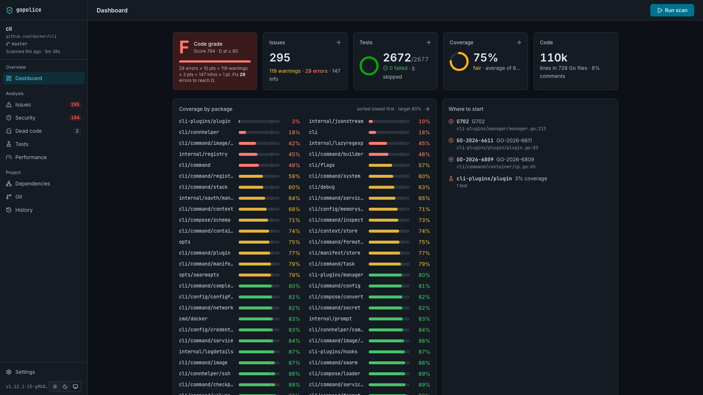
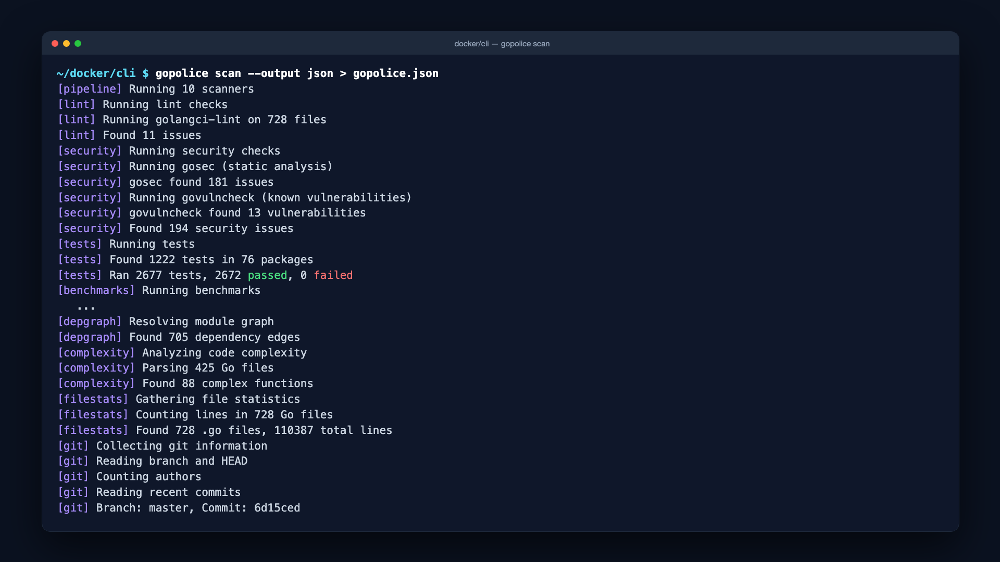
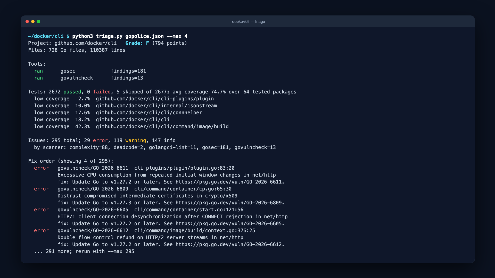
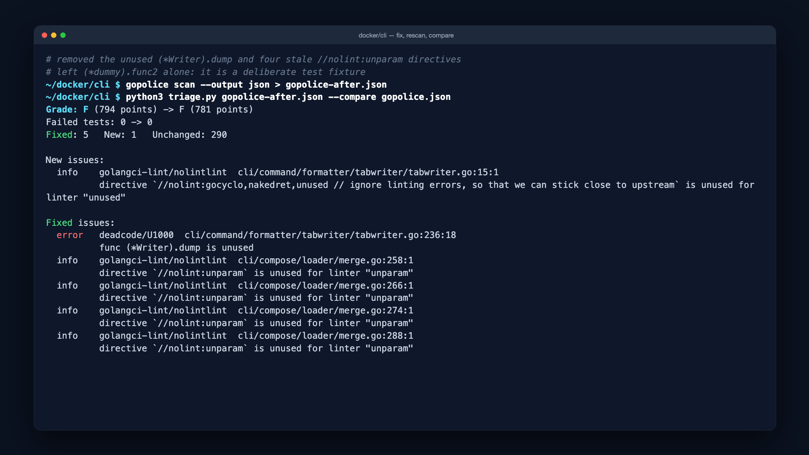
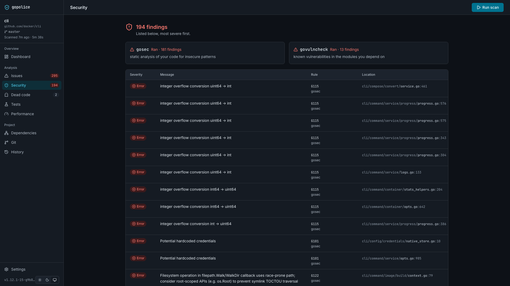
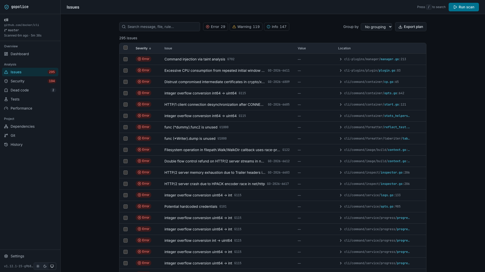
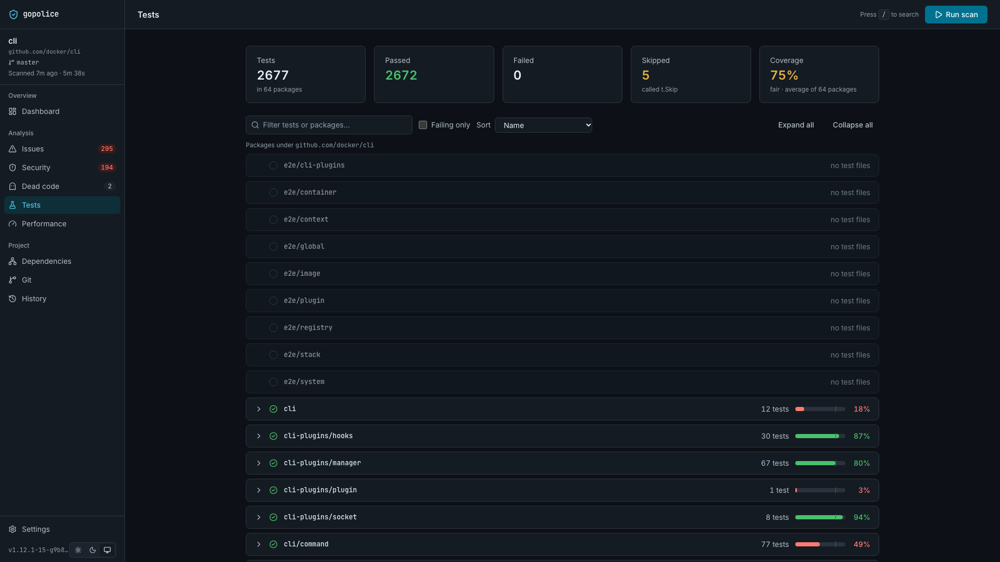
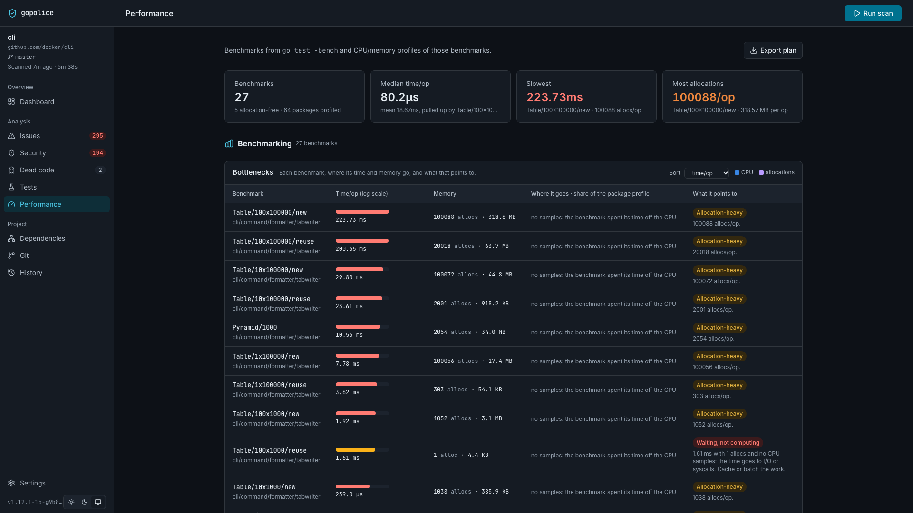

# gopolice skill for AI agents

The gopolice skill teaches an AI coding agent to audit a Go project, grade it,
and work through the findings in the right order. It is distributed on
[Agensi](https://www.agensi.io) and runs through the agent you already use.
Nothing is uploaded: the agent runs gopolice on your machine and reads the
report locally.



## Requirements

| Requirement | Why |
|-------------|-----|
| Go 1.26 or newer on `PATH` | gopolice is installed with `go install` and runs `go vet` and `go test` |
| Python 3 | the bundled triage script, standard library only |
| macOS or Linux | arm64 and amd64 |
| Network access | `go install`, and govulncheck's vulnerability database |
| An agent connected to Agensi over MCP | Claude Code, Cursor, Codex and others |

Optional tools add scanners. The agent tells you which ones are missing
instead of installing them silently:

| Tool | Adds | Install |
|------|------|---------|
| golangci-lint | full lint suite | `go install github.com/golangci/golangci-lint/cmd/golangci-lint@latest` |
| gosec | security rules | `go install github.com/securego/gosec/v2/cmd/gosec@latest` |
| govulncheck | known vulnerabilities in dependencies | `go install golang.org/x/vuln/cmd/govulncheck@latest` |
| staticcheck | dead code | `go install honnef.co/go/tools/cmd/staticcheck@latest` |

## Connect your agent

The skill is never downloaded. Your agent fetches it from Agensi's remote MCP
server each time it needs it.

1. Buy the skill on Agensi and sign in.
2. Add the Agensi MCP server to your agent. For Claude Code:

   ```bash
   claude mcp add --transport http agensi https://mcp.agensi.io/mcp/auth
   ```

   Other clients take the same URL in their MCP settings. Follow the
   connection steps on your Agensi account page; they are the source of truth
   for your client.
3. Complete the OAuth login when the agent asks.

## Ask for an audit

Open a Go repository in your agent and ask in plain words:

```
Use my Agensi skill "gopolice" to audit this Go project. Give me the quality
grade, the top security issues, and what to fix first.
```

Other prompts that work:

- "Run gopolice and tell me why the grade is a D."
- "Audit this repo before the release and fix the security errors."
- "Give me a SARIF report from this project for GitHub code scanning."
- "Find dead code and packages with low coverage in this workspace."

## What the agent does

### 1. Installs gopolice if it is missing

```bash
gopolice version || go install github.com/rapando/gopolice@latest
```

### 2. Runs a headless scan

```bash
gopolice scan --output json > gopolice.json
```

One command runs go vet, golangci-lint, gosec, govulncheck, staticcheck,
`go test` with coverage, every benchmark, and CPU and memory profiling. The
report goes to stdout, progress to stderr. No browser opens and no server is
left running.



Scans execute the project's tests and benchmarks, so only scan repositories
you trust, and expect minutes rather than seconds on large projects.

### 3. Triages the report

The skill ships a script that reads the JSON and prints what to fix first:

```bash
python3 triage.py gopolice.json
```



The order is deliberate:

1. Tool gaps. A scanner that did not run means that area is unchecked, not
   clean, and the agent says so.
2. Failing tests.
3. Known vulnerabilities (govulncheck) and security findings (gosec).
4. Vet and lint errors.
5. Warnings, then dead code, then complexity.
6. Info-level findings last.

### 4. Fixes, rescans, compares

The agent makes small, behaviour-preserving fixes, rescans, and diffs the two
reports so you see what was fixed, what is new, and the grade before and
after:

```bash
gopolice scan --output json > gopolice-after.json
python3 triage.py gopolice-after.json --compare gopolice.json
```



### 5. Hands you the dashboard

When you want to browse the results yourself, the agent starts the web UI on
the cached report without rescanning:

```bash
gopolice serve
```

It listens on localhost only. Ctrl-C stops it.

| Security | Issues |
|----------|--------|
|  |  |

| Tests | Performance |
|-------|-------------|
|  |  |

## Reading the grade

The grade is computed from issue severities. An error costs 10 points, a
warning 3, an info 1.

| Grade | Points |
|-------|--------|
| A | 0 |
| B | 1 to 15 |
| C | 16 to 40 |
| D | 41 to 80 |
| F | above 80 |

Removing one error is worth more than removing three warnings, which is why
the agent fixes errors first.

Each issue names the tool that found it: `gosec`, `govulncheck`,
`golangci-lint`, `go vet`, `go test`, `deadcode` or `complexity`. gosec HIGH
is an error, MEDIUM a warning, LOW an info. govulncheck findings carry the
`GO-YYYY-NNNN` id as the rule and the fixed version in the suggested fix.

## Options

**Skip benchmarks and profiling** on large projects by adding to
`~/.config/gopolice/config.yaml`:

```yaml
disabled_scanners:
  - benchmarks
  - profile
```

Scanner names: `lint`, `security`, `tests`, `benchmarks`, `profile`,
`deadcode`, `depgraph`, `complexity`, `filestats`, `git`.

**SARIF for CI or GitHub code scanning:**

```bash
gopolice scan --output sarif > gopolice.sarif
```

**Workspaces.** With a `go.work` file every scanner runs per module and the
agent groups findings by module.

**Cache and history.** The last report is cached at
`.gopolice/cache/result.json` and every scan is appended to
`.gopolice/history/`. Add `.gopolice/` to `.gitignore`.

## Privacy and safety

- Everything runs on your machine. The report never leaves it unless you
  share it.
- The skill only needs the Agensi MCP connection to fetch its instructions.
- Scans run your tests and benchmarks. Treat a scan like running `go test`.
- gopolice reports; it does not change code. Your agent makes the edits, and
  the skill tells it to keep each change small and to preserve behaviour.

## Troubleshooting

**`gopolice: command not found` after install.** `go install` puts binaries in
`$(go env GOPATH)/bin`. Add that directory to `PATH`.

**"govulncheck did not run" in the triage output.** govulncheck is missing or
could not reach the vulnerability database. Install it or check network
access, then rescan. Until then, vulnerabilities are unchecked, not absent.

**The scan takes too long.** Disable `benchmarks` and `profile` as shown
above. Tests still run.

**The grade did not change after fixes.** Check the compare output. New
issues introduced by the fix cancel out the ones removed, and only errors
move the score meaningfully.

**The agent cannot find the skill.** Confirm the Agensi MCP server is
connected and the OAuth login completed, then ask again naming the skill:
"Use my Agensi skill gopolice".

## Support

- gopolice itself: [github.com/rapando/gopolice](https://github.com/rapando/gopolice),
  issues welcome.
- The skill source lives in the [`skill/`](../skill) directory of the same
  repository.
- Billing and access to the skill: your Agensi account.

gopolice is open source under the MIT license.
